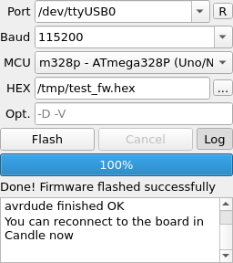

# STK500 Flasher — firmware flasher plugin for Candle

[](LICENSE)
[](https://github.com/YOUR-USERNAME/candle-plugin-stk500-flasher/releases)
[](#installation)
[](https://github.com/Denvi/Candle)
[](README.ru.md)

**candle-plugin-stk500-flasher** adds a firmware flasher panel to
[Candle](https://github.com/Denvi/Candle), the GRBL CNC controller.
Flash GRBL — or any AVR/Arduino firmware — onto your CNC board
**without leaving Candle**: no Arduino IDE, no XLoader, no command line.



*The plugin panel in Candle's user-panel area after a successful flash
(English UI; the plugin follows Candle's language — Russian is also built in,
see [README.ru.md](README.ru.md)).*

## Why

The usual ritual for updating GRBL firmware: close the port in Candle, open
the Arduino IDE or XLoader, figure out the right board/programmer settings,
flash, close it, reopen Candle and reconnect. This plugin collapses all of
that into one small panel that lives in Candle's side area next to the other
user panels:

- **The same mechanism as the Arduino IDE "Upload" button** — the Arduino
  STK500 v1 (Optiboot) protocol through the board's own USB-UART, driven by
  [avrdude](https://github.com/avrdudes/avrdude).
- **The programmer type is fixed** (`avrdude -c stk500v1`): there is no
  programmer list to misconfigure. Boards that don't answer are fixed by
  picking the right **baud rate**, not by protocol roulette.
- **Port pre-filled from Candle's own connection settings** and re-synced
  automatically when you change them in Candle's Settings dialog.
- **HEX sanity checks before flashing**: file validity, image size vs. MCU
  flash size, a warning when the image reaches the bootloader area.
- **Live progress, full log, cancel**: write/verify progress bar, collapsible
  avrdude output log (auto-opens on errors), a Stop button.
- **Compact**: the collapsed panel is about 150×210 px and fits Candle's user
  panel area without scrollbars.
- **Cross-platform**: Windows and Linux (macOS works too). avrdude is
  auto-discovered — a copy bundled with the plugin, the Candle app folder,
  the Arduino IDE, PlatformIO, the system `PATH` — or set your own path in
  the plugin settings.
- **Tiny**: the lite build is a 17 KB ZIP with zero dependencies.

## How it works

Candle 10.9+ loads plugins from the `candleplugins/` folder: each plugin is a
`config.ini` (metadata) + `script.js` (logic, QtScript) + Qt Designer `.ui`
forms. The heavy lifting is delegated to avrdude, invoked exactly like the
Arduino IDE does it:

```bash
avrdude -c stk500v1 -P <port> -b <baud> -p <mcu> -U flash:w:<firmware.hex>:i -v
```

Why `-c stk500v1` only? Because everything else in the avrdude programmer
list is irrelevant when flashing through the board's own serial port:
`usbasp`/`usbtinyisp`/`avrisp` are *external hardware programmers*, and
`wiring` is the STK500 v2 flavor used by the Mega 2560 stock bootloader.
Keeping a programmer dropdown was an invitation to break a working setup, so
as of v2.2 the protocol is fixed and the panel got simpler and narrower.

## Installation

### From a release ZIP (recommended)

1. Download a ZIP from the
   [Releases](https://github.com/YOUR-USERNAME/candle-plugin-stk500-flasher/releases)
   page:
   - **lite** (17 KB) — plugin files only, uses a system-wide avrdude;
   - **full** (1 MB) — bundles avrdude 8.0 for Windows x64
     (`avrdude.exe` + `avrdude.conf`), nothing else to install.
2. Find your Candle folder (next to `candle.exe` / `candle`) and copy the
   `stk500flasher` folder into `candleplugins` (create it if needed):

```
Candle/
├── candle(.exe)
└── candleplugins/
    └── stk500flasher/
        ├── config.ini
        ├── script.js
        ├── widget.ui
        ├── settings.ui
        ├── README.md
        └── avrdude/            (full ZIP only, Windows)
            ├── avrdude.exe
            ├── avrdude.conf
            └── LICENSE
```

3. Restart Candle — the "STK500 Flasher" panel appears in the right-hand
   user panel area.

### avrdude setup

| OS | lite ZIP | full ZIP |
|----|----------|----------|
| **Windows** | install the Arduino IDE, or pick `avrdude.exe` in *Settings → STK500 Flasher* | nothing to do — bundled |
| **Linux** | `sudo apt install avrdude` (or `dnf` / `pacman` / `zypper`), found in `PATH` automatically | same — the bundled copy is Windows-only |
| **macOS** | `brew install avrdude` | same |

A custom avrdude and/or `avrdude.conf` can always be selected in
*Settings → STK500 Flasher*.

### From source

```bash
git clone https://github.com/YOUR-USERNAME/candle-plugin-stk500-flasher.git
cp -r candle-plugin-stk500-flasher/stk500flasher <your Candle folder>/candleplugins/
```

(`scripts/package.sh` rebuilds the distributable ZIPs.)

## Usage

1. **Disconnect Candle from the board** (*Connection → Disconnect*) — the
   serial port must be free for flashing.
2. In the "STK500 Flasher" panel:
   - **Port** — pre-filled from Candle's settings; rescan with the `R`
     button and pick another one if needed;
   - **Baud** — 115200 for Uno/Nano (Optiboot), 57600/19200 for old boards;
     the field is editable for exotic values;
   - **MCU** — the target controller, e.g. `m328p` for Uno/Nano/GRBL;
   - **HEX** — the firmware file (Intel HEX), e.g. `grbl.hex`;
   - **Opt.** — extra avrdude options, space-separated (`-D` don't erase the
     whole chip, `-V` don't verify, `-F` ignore signature — with care).
3. Press **Flash**. The progress bar tracks write/verify, the detailed
   avrdude output goes to the log (button **Log**, opens automatically on
   flashing and errors), and the status line ends with
   *"Done! Firmware flashed successfully"* — or a human-readable hint about
   what went wrong.
4. If your board doesn't auto-reset into the bootloader, press **RESET** on
   the board right after clicking Flash.
5. Reconnect Candle to the board — done.

### Supported MCUs

| MCU (`-p`) | Typical boards | Flash |
|------------|----------------|-------|
| `m328p` | Uno, Nano, most GRBL boards | 32 KB |
| `m328` | Uno/Nano clones with ATmega328 | 32 KB |
| `m2560` | Mega 2560 — **only with Optiboot on board** (see FAQ) | 256 KB |
| `m1284p` | Sanguino / RepRap boards | 128 KB |
| `m644p` | Sanguino variants | 64 KB |
| `m168p` / `m168` / `m88` / `m8` | legacy Arduino | 16/16/8/8 KB |

### Compared to the alternatives

| | this plugin | XLoader | Arduino IDE | avrdude CLI |
|---|---|---|---|---|
| Lives inside Candle | ✅ | ❌ separate app | ❌ ~1 GB IDE | ❌ terminal |
| Protocol choice | fixed STK500 v1, nothing to mispick | fixed per board | per-board | manual `-c` |
| Progress / log / cancel | ✅ / ✅ / ✅ | progress only | ✅ / ✅ / ❌ | raw stderr |
| HEX pre-checks (size, bootloader area) | ✅ | ❌ | ✅ | ❌ |
| Port from Candle settings | ✅ | manual | manual | manual |
| RU + EN UI | ✅ | EN only | many | — |

## Troubleshooting / FAQ

**"not in sync" / `stk500_getsync() attempts: -1`** — the bootloader didn't
answer. Checklist: (1) Candle is disconnected from the port; (2) the baud
rate matches your bootloader (115200 for Optiboot, 57600/19200 for old
boards); (3) the board is actually in its bootloader — press RESET on the
board right after clicking Flash if auto-reset (DTR) doesn't work; (4) try
another USB cable — thin charge-only cables drop data lines.

**"Device signature mismatch"** — the selected MCU doesn't match the chip.
Fix the MCU field; forcing with `-F` in the options field writes to the
wrong chip layout and can brick it.

**"Port is busy / access denied"** — the port is held by Candle or another
program: *Connection → Disconnect* first. On Linux, add yourself to the
`dialout` group (`sudo usermod -aG dialout $USER`, re-login) if the error
persists.

**Does it work with Mega 2560?** The Mega 2560 **stock** bootloader speaks
STK500 **v2** (the "wiring" flavor), so it does not answer STK500 v1 — this
plugin deliberately supports v1 only. Flash such boards with an external
programmer, or burn Optiboot onto them once — after that the plugin works
with `m2560` normally.

**"avrdude not found"** — install it (see the table above) or point the
plugin to your binary in *Settings → STK500 Flasher*. The detected path is
shown right in the settings page.

**Is this the same as the Arduino IDE upload?** Yes — the same avrdude
STK500 v1 session over the same USB-UART with the same DTR auto-reset, so
anything the IDE can flash through the serial port, this panel can too.

## Development

The plugin is plain QtScript + Qt Designer forms — no compilation. It was
verified end-to-end against Candle built from sources (offscreen platform)
with a mock avrdude that mimics the real stderr progress output; the harness
lives in [`tests/`](tests/README.md). Known quirks of Candle's QtScript
bindings are documented inline in `script.js` (ambiguous signal overloads,
`String(QByteArray)`, missing setter methods, no `QProcess.MergedChannels`).

## License & credits

- This plugin: **GPL-3.0** (same license as Candle) — see [LICENSE](LICENSE).
- [Candle](https://github.com/Denvi/Candle) — the GRBL controller this plugin
  extends.
- [avrdude](https://github.com/avrdudes/avrdude) — Brian Dean, Joerg Wunsch
  and the avrdudes project (GPLv2); the full ZIP bundles avrdude 8.0
  Windows x64 binaries.
- STK500 v1 / Optiboot protocol as implemented by the Arduino IDE.
