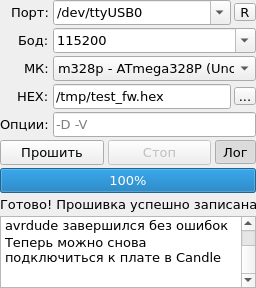

# STK500 Flasher — плагин прошивки плат для Candle

[](LICENSE)
[](https://github.com/YOUR-USERNAME/candle-plugin-stk500-flasher/releases)
[](#установка)
[](https://github.com/Denvi/Candle)
[](README.md)

**candle-plugin-stk500-flasher** добавляет в [Candle](https://github.com/Denvi/Candle)
(GRBL-управляющую программу для ЧПУ) панель прошивки плат управления.
Прошивайте GRBL — или любую прошивку для AVR/Arduino — **не выходя из Candle**:
без Arduino IDE, без XLoader, без командной строки.



*Панель плагина в пользовательской области Candle после успешной прошивки
(русская локализация; язык панели следует за языком Candle — английский
тоже встроен, см. [README.md](README.md)).*

## Зачем это нужно

Обычный ритуал обновления прошивки GRBL: закрыть порт в Candle, открыть
Arduino IDE или XLoader, разобраться с настройками платы/программатора,
прошить, закрыть, снова открыть Candle и подключиться. Этот плагин сворачивает
всё в одну маленькую панель, которая живёт в боковой области Candle рядом
с прочими пользовательскими панелями:

- **Тот же механизм, что кнопка «Загрузка» в Arduino IDE** — протокол
  Arduino STK500 v1 (Optiboot) через собственный USB-UART платы, движок —
  [avrdude](https://github.com/avrdudes/avrdude).
- **Тип программатора зафиксирован** (`avrdude -c stk500v1`): списка
  программаторов, в котором можно ошибиться, больше нет. Если плата не
  отвечает — подбирается **скорость (Бод)**, а не протокол наугад.
- **Порт подставляется из настроек самого Candle** и автоматически
  обновляется при их смене в окне настроек.
- **Проверки HEX до прошивки**: корректность файла, размер образа относительно
  flash-памяти контроллера, предупреждение при заходе в область загрузчика.
- **Живой прогресс, полный лог, отмена**: индикатор записи/верификации,
  сворачиваемый журнал avrdude (автоматически открывается при ошибках),
  кнопка «Стоп».
- **Компактность**: свёрнутая панель ~150×210 px, помещается в панельную
  область Candle без скроллбаров.
- **Кроссплатформенность**: Windows и Linux (macOS тоже работает). avrdude
  находится автоматически — копия из папки плагина, папка Candle, Arduino IDE,
  PlatformIO, системный `PATH` — либо задаётся вручную в настройках.
- **Крошечный размер**: lite-сборка — ZIP на 17 КБ без зависимостей.

## Как это работает

Candle 10.9+ загружает плагины из папки `candleplugins/`: каждый плагин —
это `config.ini` (метаданные) + `script.js` (логика, QtScript) + формы
Qt Designer (`.ui`). Вся работа с протоколом делегируется avrdude, который
вызывается ровно так же, как это делает Arduino IDE:

```bash
avrdude -c stk500v1 -P <порт> -b <скорость> -p <мк> -U flash:w:<прошивка.hex>:i -v
```

Почему только `-c stk500v1`? Потому что всё остальное в списке программаторов
avrdude не имеет отношения к прошивке через собственный последовательный порт
платы: `usbasp`/`usbtinyisp`/`avrisp` — это *внешние аппаратные
программаторы*, а `wiring` — вариант STK500 v2 для штатного загрузчика
Mega 2560. Выпадающий список программаторов был приглашением сломать
рабочую конфигурацию, поэтому с версии 2.2 протокол зафиксирован, а панель
стала проще и уже.

## Установка

### Из релизного ZIP (рекомендуется)

1. Скачайте ZIP со страницы
   [Releases](https://github.com/YOUR-USERNAME/candle-plugin-stk500-flasher/releases):
   - **lite** (17 КБ) — только файлы плагина, используется системный avrdude;
   - **full** (1 МБ) — с avrdude 8.0 для Windows x64
     (`avrdude.exe` + `avrdude.conf`), ставить больше ничего не нужно.
2. Найдите папку программы Candle (рядом с `candle.exe` / `candle`) и
   скопируйте папку `stk500flasher` в `candleplugins` (при необходимости
   создайте её):

```
Candle/
├── candle(.exe)
└── candleplugins/
    └── stk500flasher/
        ├── config.ini
        ├── script.js
        ├── widget.ui
        ├── settings.ui
        ├── README.md
        └── avrdude/            (только full-ZIP, Windows)
            ├── avrdude.exe
            ├── avrdude.conf
            └── LICENSE
```

3. Перезапустите Candle — в правой панельной области появится блок
   «STK500 Flasher».

### Настройка avrdude

| ОС | lite-ZIP | full-ZIP |
|----|----------|----------|
| **Windows** | установите Arduino IDE или укажите `avrdude.exe` в *Настройки → STK500 Flasher* | ничего делать не нужно — уже в комплекте |
| **Linux** | `sudo apt install avrdude` (или `dnf` / `pacman` / `zypper`), найдётся в `PATH` автоматически | так же — встроенная копия только для Windows |
| **macOS** | `brew install avrdude` | так же |

Свой avrdude и/или `avrdude.conf` всегда можно указать в
*Настройки → STK500 Flasher*.

### Из исходников

```bash
git clone https://github.com/YOUR-USERNAME/candle-plugin-stk500-flasher.git
cp -r candle-plugin-stk500-flasher/stk500flasher <папка Candle>/candleplugins/
```

(`scripts/package.sh` пересобирает дистрибутивные ZIP-архивы.)

## Использование

1. **Отключите Candle от платы** (*Соединение → Отключиться*) — порт должен
   быть свободен для прошивки.
2. В панели «STK500 Flasher»:
   - **Порт** — подставляется из настроек Candle; кнопка `R` обновляет
     список, при необходимости выберите другой;
   - **Бод** — 115200 для Uno/Nano (Optiboot), 57600/19200 для старых плат;
     поле редактируется для нестандартных значений;
   - **МК** — целевой контроллер, например `m328p` для Uno/Nano/GRBL;
   - **HEX** — файл прошивки (Intel HEX), например `grbl.hex`;
   - **Опции** — дополнительные опции avrdude через пробел (`-D` не стирать
     весь чип, `-V` не проверять, `-F` игнорировать сигнатуру — осторожно).
3. Нажмите **«Прошить»**. Индикатор показывает запись/верификацию,
   подробный вывод avrdude идёт в журнал (кнопка «Лог», автоматически
   открывается при прошивке и ошибках), строка состояния заканчивается
   «Готово! Прошивка успешно записана» — либо человекочитимой подсказкой,
   что именно не так.
4. Если плата не сбрасывается в загрузчик автоматически, нажмите **RESET**
   на плате сразу после нажатия «Прошить».
5. Снова подключитесь к плате в Candle — готово.

### Поддерживаемые МК

| МК (`-p`) | Типичные платы | Flash |
|-----------|----------------|-------|
| `m328p` | Uno, Nano, большинство GRBL-плат | 32 КБ |
| `m328` | клоны Uno/Nano на ATmega328 | 32 КБ |
| `m2560` | Mega 2560 — **только при наличии Optiboot** (см. FAQ) | 256 КБ |
| `m1284p` | Sanguino / платы RepRap | 128 КБ |
| `m644p` | варианты Sanguino | 64 КБ |
| `m168p` / `m168` / `m88` / `m8` | старые Arduino | 16/16/8/8 КБ |

### Сравнение с альтернативами

| | этот плагин | XLoader | Arduino IDE | avrdude в консоли |
|---|---|---|---|---|
| Живёт внутри Candle | ✅ | ❌ отдельное приложение | ❌ IDE на ~1 ГБ | ❌ терминал |
| Выбор протокола | зафиксирован STK500 v1, ошибиться негде | фиксированный по плате | по плате | вручную `-c` |
| Прогресс / лог / отмена | ✅ / ✅ / ✅ | только прогресс | ✅ / ✅ / ❌ | сырой stderr |
| Проверки HEX (размер, область загрузчика) | ✅ | ❌ | ✅ | ❌ |
| Порт из настроек Candle | ✅ | вручную | вручную | вручную |
| Русский + английский интерфейс | ✅ | только EN | много языков | — |

## Решение проблем / FAQ

**«not in sync» / `stk500_getsync() attempts: -1`** — загрузчик не ответил.
Чек-лист: (1) Candle отключён от порта; (2) скорость совпадает с загрузчиком
(115200 для Optiboot, 57600/19200 для старых плат); (3) плата действительно
находится в загрузчике — нажмите RESET на плате сразу после «Прошить», если
авто-сброс (DTR) не срабатывает; (4) попробуйте другой USB-кабель — тонкие
«зарядные» кабели часто без линий данных.

**«Device signature mismatch» (сигнатура не совпала)** — выбранный МК не
соответствует чипу. Исправьте поле «МК»; принудительное продолжение через
`-F` в опциях пишет по чужой раскладке памяти и может окирпичить плату.

**«Порт занят / доступ запрещён»** — порт удерживается Candle или другой
программой: сначала *Соединение → Отключиться*. На Linux, если ошибка
остаётся, добавьте себя в группу `dialout`
(`sudo usermod -aG dialout $USER`, перелогиньтесь).

**Работает ли с Mega 2560?** **Штатный** загрузчик Mega 2560 говорит по
STK500 **v2** (вариант «wiring») и на v1 не отвечает — плагин сознательно
поддерживает только v1. Прошивайте такие платы внешним программатором или
один раз запишите Optiboot — после этого плагин работает с `m2560` как
обычно.

**«avrdude не найден»** — установите его (таблица выше) или укажите свой
бинарник в *Настройки → STK500 Flasher*. Найденный путь показывается прямо
на странице настроек.

**Это то же самое, что загрузка через Arduino IDE?** Да — тот же сеанс
avrdude STK500 v1 через тот же USB-UART с тем же авто-сбросом по DTR, так
что всё, что IDE шьёт через последовательный порт, прошивает и эта панель.

## Разработка

Плагин — это чистый QtScript + формы Qt Designer, без компиляции. Он
проверен end-to-end на Candle, собранном из исходников (платформа
offscreen), с mock-avrdude, воспроизводящим реальный вывод прогресса в
stderr; тестовый стенд — в [`tests/`](tests/README.md). Известные
особенности QtScript-биндингов Candle задокументированы прямо в коде
`script.js` (перегруженные сигналы, `String(QByteArray)`, отсутствующие
сеттеры, недоступный `QProcess.MergedChannels`).

## Лицензия и благодарности

- Этот плагин: **GPL-3.0** (как и сам Candle) — см. [LICENSE](LICENSE).
- [Candle](https://github.com/Denvi/Candle) — программа, для которой написан
  плагин.
- [avrdude](https://github.com/avrdudes/avrdude) — Brian Dean, Joerg Wunsch
  и проект avrdudes (GPLv2); full-ZIP содержит бинарники avrdude 8.0 для
  Windows x64.
- Протокол STK500 v1 / Optiboot в том виде, в котором его реализует Arduino
  IDE.
